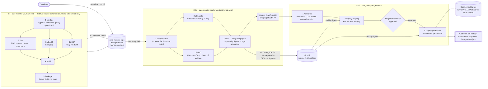

# 10 · Final secure CI/CD architecture (Final Architecture Challenge)

## How each requirement is met
| # | Question | Answer |
|---|---|---|
| 1 | How developers submit changes | Branch → PR to `main`; protected branch needs green "CI evidence", 1 approval, code-owner review |
| 2 | How the CI/CD platform executes jobs | GitHub Actions on ephemeral GitHub-hosted VMs, one per job; reusable workflows per stage |
| 3 | Tests & scans | CI: tests, Semgrep (SAST), Trivy (SCA + SBOM); CDL: Gitleaks/Trivy secrets |
| 4 | Terraform validation | CDL 2b: fmt, validate, Checkov, Trivy config, tfsec — before any apply |
| 5 | Images built & scanned | CDL 3: built from verified SHA, Trivy image gate, then pushed |
| 6 | Approved artifacts stored | GHCR, immutable digest, signed provenance attestation, release manifest |
| 7 | Pipeline identities' permissions | Per-job `GITHUB_TOKEN` scopes; read-only PAT; OIDC → short-lived AWS roles (plan read-only / deployer prod-only) |
| 8 | Secrets protection | Environment secrets (masked, env-scoped), generated randomly, never in code, `.env` mode 600 on runner |
| 9 | Production authorization | `main` only + CDL success + valid attestation + required reviewer on `production` |
| 10 | Trace & investigate | commit → CI run → CDL run → digest/attestation → CDP run → approver → deployed record |

## Design review
**Preventive:** branch protection, CODEOWNERS, all gates (SAST/SCA/secrets/IaC/image), publication rules, authorize rules, environment protection & approval, least-privilege tokens, env-scoped secrets, SHA-pinned actions, non-root/cap-drop containers, WAF/SG/private subnets.
**Detective:** scan reports, policy guard, SARIF in Security tab, Dependabot, audit trail, VPC Flow Logs, CloudWatch/WAF logs, smoke tests.
**Corrective:** automatic rollback, runbook, credential rotation script, Dependabot PRs, exceptions with expiry.

**Highest risks:** the CI/CD platform itself (holds signing ability and prod secrets), the PAT, the production environment reviewer account (phishing), third-party actions/tools (supply chain), the registry.

**CI/CD platform unavailable:** nothing can be delivered → production keeps running the last release; emergency = documented manual deploy of an already-approved digest with two people, logged.

**Registry compromised:** attacker can push new images/tags but cannot forge our attestation nor change a digest's content → `gh attestation verify` + pull-by-digest refuse them. Response: rotate access, re-verify every deployed digest, rebuild from source.

**Revoke a compromised deployment credential:** environment secret → rerun `setup-github.sh` (new values) and redeploy; PAT → revoke in GitHub settings, create new one; AWS → nothing long-lived to revoke (OIDC), tighten the role trust policy if needed; review audit logs.

**Roll back a vulnerable release:** run CDP with the previous good `cdl_run_id` (approval required) — redeploys the old digests; then fix forward.

**Financial application:** two-person approval (prevent self-review), signed commits, mandatory DAST + pentest, WORM log storage, HSM/KMS-backed signing, change-advisory evidence, PCI-DSS/SOC 2 controls, runtime admission control (only signed images run), secrets in a vault with dynamic credentials, separate AWS accounts per environment.

**50 teams:** shared reusable workflows in a central "platform" repo (versioned, called by SHA), org-level rulesets instead of per-repo protection, org-wide required workflows, central exception register, self-service environments, scanner results aggregated (e.g. DefectDojo), dedicated runner groups per trust level.
